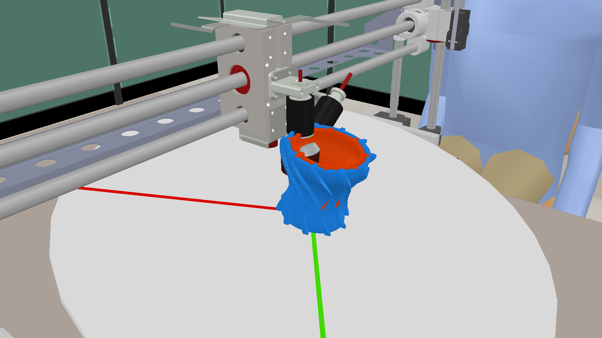

# Parametric five-axis nozzle G-code demonstrator

Semester-project baseline: a local Python/HTML generator for a converging–diverging nozzle with curved fins and two simulated materials, connected to the existing FIBR3DEmul deposition simulator in CoppeliaSim.

**Simulation only. Never run these files on a physical machine.** The scene has an XYZ-moving head and a B/C rotating table; it is not a validated Haas UMC-1000SS–Meltio digital twin.



## Run the code generator

Python 3.9 or newer; no third-party packages required for the web interface or generation.

```sh
cd outputs/gcode-generator
python3 app.py
```

Open http://127.0.0.1:8000/. Set dimensions, fin counts/twist, and bead/layer spacing, then generate or download the expanded XYZBC program. Simulation buttons require the additional setup below. On macOS, `Start Nozzle Demo.command` is an alternative launcher.

## How it works

1. `generator.py` defines the smooth radius-versus-height profile and parameter validation.
2. `fibr3d_export.py` generates helical shell tracks and twisted fin tracks, then compensates XYZ for the calibrated B/C pivots.
3. `app.py` serves `static/simulator.html` and local JSON endpoints.
4. `simulation_runner.py` launches the external simulator and Python playback adapter.
5. `play_gcode.py` reads the generated moves and drives the existing FIBR3DEmul motion/deposition plugin.

Build order: inner shell → inner fins → outer shell → outer fins. T1/T2 select visual material colours; M80/M81 are simulation flags, not verified Meltio commands. B follows profile slope with a tilt cap; C advances 120 degrees over the height. This is a demonstration orientation law, not an optimized process plan.

The older `/index.html` page and Rep5x/Penta exporters are retained as historical experiments. They are not the current full deposition workflow.

## Simulator setup: Apple Silicon Mac

The working baseline used CoppeliaSim Edu 4.10 ARM64 and Python 3.9.6. Install CoppeliaSim separately from https://www.coppeliarobotics.com/ and comply with its educational-use eligibility/license. The application is intentionally not redistributed here.

1. Place the app at `outputs/simulator-review/CoppeliaSim.app` (the launcher currently expects this path).
2. From the repository root, create the adapter environment:

```sh
python3 -m venv outputs/simulator-review/.venv
outputs/simulator-review/.venv/bin/python -m pip install -r requirements-simulator.txt
```

3. Install Apple's command-line build tools and Homebrew Boost if needed. The baseline used Boost 1.92.0. Build the patched legacy plugin from source:

```sh
cd outputs/simulator-review/FIBR3DEmul/v-rep_plugin
clang++ -O2 -std=c++14 -dynamiclib -fPIC -Dio_service=io_context \
  -DBOOST_BIND_GLOBAL_PLACEHOLDERS -Wno-enum-compare-switch \
  -Wno-pragma-once-outside-header -Iinclude -Icoppelia/include \
  -Icoppelia/include/stack -Ispdlog -I/opt/homebrew/include \
  simExtFIBR3D.cpp src/*.cpp coppelia/common/simLib.cpp \
  coppelia/common/stack/*.cpp -L/opt/homebrew/lib -lboost_thread \
  -o ../../libsimExtFIBR3D.dylib
cp ../../libsimExtFIBR3D.dylib ../../CoppeliaSim.app/Contents/MacOS/
```

4. Start the generator and click **Run in CoppeliaSim**. The launcher opens the included `nozzle_scene.ttt`. Close any floating filament controls that obscure the scene. Pause/resume is available from the webpage.

The simulator setup is platform-specific. The generator itself does not require macOS; Windows/Linux simulation launch and plugin builds need adaptation. The packaged tests have been rerun, but this installation procedure has not been tested on a second clean computer.

## Tests and evidence

```sh
cd outputs/gcode-generator
../simulator-review/.venv/bin/python -m unittest test_generator test_fibr3d -v
```

The full suite requires the simulator Python dependencies above (but not a running simulator). For generator-only tests, use `python3 -m unittest test_generator -v`.

The included `video_verification.json` is evidence from the recorded baseline, not a fresh validation of arbitrary parameter sets. The full 1080p video is attached to the repository's baseline release rather than stored in Git history.

With FFmpeg installed and the scene open, export another recording from `outputs/simulator-review`:

```sh
.venv/bin/python export_video.py --program baseline_program.nc --output my-build.mp4
```

## Engineering limitations

- Numerical motion agreement does not establish manufacturing accuracy.
- No validated collision-free head/fixture access, unsupported-deposition strategy, thermal model, metallurgy, or real Meltio I/O.
- Two colours do not prove two-material compatibility.
- The calibrated scene pivots are not physical Haas MRZP measurements.
- Retractions, feed strategy, deposition sequencing and material support require engineering review before any real build.

## Collaboration

Keep the repository private for now. Invite collaborators through GitHub Settings → Collaborators; they need explicit access to clone this repository or view its release video. Use branches and pull requests; run the tests before proposing changes. Do not commit credentials, local environments, simulator applications, or generated capture frames.

## Third-party attribution

The included FIBR3DEmul plugin source is from https://github.com/neuebot/FIBR3DEmul at commit `bd2e549ddcc47e295edfb803f8d82aa1a0194147`, with local modifications to `simExtFIBR3D.cpp`, `src/Server.cpp`, and `src/VelocityProfile.cpp`. These address Mac compatibility, joint transforms, queue/network handling, endpoints, telemetry, and camera visibility. Its GPL-3.0 license is retained in that directory, alongside bundled dependency notices. The scene is derived from the upstream machine scene.

CoppeliaSim remains a separately licensed dependency. No new blanket license is assigned to the project's original code in this private baseline.
